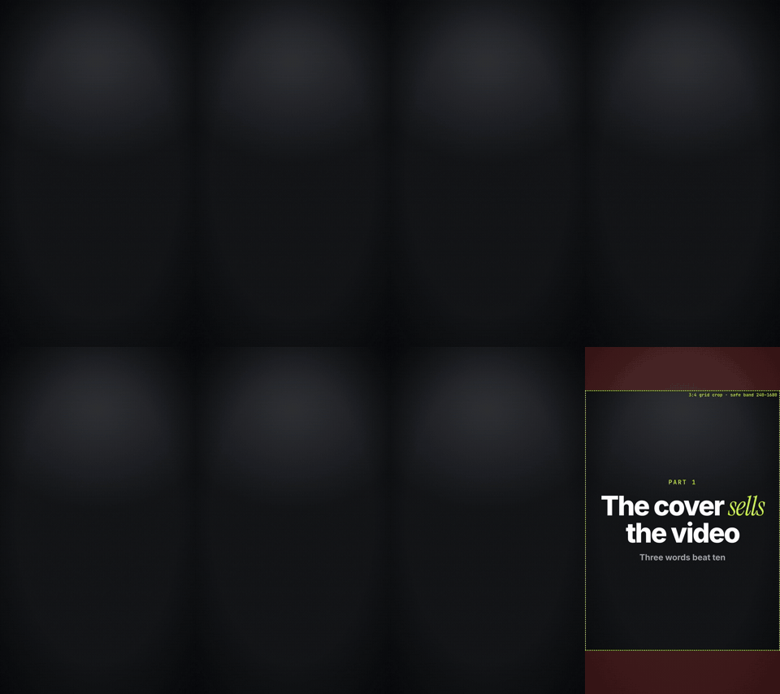

<div align="center">

# motionforge

**Motion-Design-Videos, von deinem Coding-Agenten in Code geschrieben.**

Beschreib das Video. Dein Agent schreibt Hook und Skript, legt jedes Wort zeitgenau auf das Voiceover, baut die Szenen, rendert und prüft seine eigene Arbeit, bevor du sie zu sehen bekommst.

[English](../../README.md) · [Türkçe](README.tr.md) · [Español](README.es.md) · [Português (BR)](README.pt-BR.md) · [Français](README.fr.md) · [Deutsch](README.de.md) · [简体中文](README.zh-CN.md) · [日本語](README.ja.md) · [한국어](README.ko.md) · [हिन्दी](README.hi.md)

   

</div>

<p align="center"></p>

---

## Was es macht

Du schreibst zum Beispiel:

> Mach ein 60-sekündiges Hochkant-Reel über die 5 kostenlosen Tools, die ich jeden Tag nutze. Dunkler Stil, meine Stimme, Untertitel.

motionforge macht daraus in festen Schritten ein geprüftes MP4:

| Schritt | Was passiert |
|---|---|
| **Briefing** | Der Agent fasst deine Anfrage in einem Satz zusammen und fragt nur nach, was fehlt (Format, Länge, Sprache, Stimme). |
| **Hook & Skript** | 2–3 Hook-Varianten, ein Skript im Sprechtempo und eine Liste der Tatsachenbehauptungen, die du prüfen solltest. Keine erfundenen Statistiken. Keine typischen „KI-Floskeln“ (Listen verbotener Phrasen in 10 Sprachen). |
| **Stimme** | Nutze deinen eigenen TTS-Schlüssel (ElevenLabs, OpenAI) oder ein lokales Modell. Der Agent nennt die Kosten und wartet auf dein „Ja“, bevor er einen kostenpflichtigen Aufruf macht. |
| **Timing** | Zeitstempel auf Wortebene aus dem Voiceover, damit jeder Titel, jedes Logo und jeder Untertitel genau mit dem gesprochenen Wort erscheint. |
| **Stil & Marke** | Wähl einen Look aus der Style-Bibliothek und wende deine `brand.json` an (Farben, Schriften, Logo, Wasserzeichen, Outro). |
| **Szenen** | Als deterministischer Code gebaut, in dem man zu jedem Zeitpunkt springen kann: standardmäßig HyperFrames (HTML + GSAP), Remotion oder eine Canvas-Engine, wenn sie besser passen. |
| **QA** | Kontaktabzüge, Prüfung auf Textüberlauf und Safe Area, Lesezeit auf dem Bildschirm, Lautheit und ein Kritiker mit frischem Kontext, der die Szenen nicht selbst geschrieben hat. |
| **Auslieferung** | MP4 in 9:16 / 1:1 / 16:9, ein Coverbild, Untertitel und ein Beitragstext. Änderungen per Zeitstempel: „Ändere den Titel bei 0:12“. |

## Installation

### Claude Code (Plugin)

```text
/plugin marketplace add aykutucesai/motionforge
/plugin install motionforge@motionforge
```

Danach fragst du einfach nach einem Video. Der Skill `motion-director` übernimmt.

### Codex, Cursor und andere Agenten

```bash
git clone https://github.com/aykutucesai/motionforge
```

Öffne den Ordner (oder füg ihn deinem Projekt hinzu) und verweise den Agenten auf [`AGENTS.md`](../../AGENTS.md). Jeder Skill ist schlichtes Markdown mit exakten Befehlen. Jeder Agent, der Dateien lesen und eine Shell bedienen kann, kommt damit zurecht.

### Voraussetzungen

- Node.js 18+ (22 empfohlen) und ffmpeg
- Python 3.10+
- Optional: `faster-whisper` (Wort-Timings), `rembg` (Freistellen einer sprechenden Person), `fonttools` (Glyphen-Prüfung), Playwright Chromium

Der Agent prüft das zu Beginn jedes Auftrags und sagt dir genau, was du installieren musst.

## Probier diese Prompts aus

```text
Mach aus diesem Voiceover (voice.mp3) ein 9:16-Reel. Kinetische Untertitel, dunkler Stil, echte Logos für jedes Produkt, das ich erwähne.
```
```text
Erstell aus diesen 4 Screenshots einen 30-sekündigen Launch-Clip für meine App. Nutz mein Brand-Kit.
```
```text
Schreib 3 Hook-Varianten und ein 70-sekündiges Skript auf Spanisch darüber, wie man bei Software Geld spart. Erzeug noch kein Audio.
```
```text
Hier ist ein 10-sekündiger Clip von mir am Schreibtisch. Nimm die ersten 5 Sekunden als Intro und die letzten 5 als Outro, dazwischen Grafiken.
```

## Was drin ist

```
motionforge/
├─ AGENTS.md                 Einstiegspunkt für jeden Agenten
├─ skills/
│  ├─ motion-director/       der komplette Workflow mit seinen Freigabeschritten
│  ├─ script-and-hooks/      Hooks, Skripte, Behauptungsliste, verbotene Phrasen (10 Sprachen)
│  ├─ voice-and-timing/      TTS nur mit Zustimmung, Wort-Timings, Untertitel, Lautheit
│  ├─ style-library/         20 Looks, je eine STYLE.md
│  ├─ brand-kit/             brand.json: Farben, Schriften, Logos, Wasserzeichen, Outro
│  └─ qa-review/             Prüfungen + unabhängiger Kritiker
├─ engines/
│  ├─ hyperframes/           Standard-Engine (HTML + GSAP, Apache-2.0)
│  ├─ remotion/              optionale React-Engine + Kit
│  └─ canvas/                frame = f(t)-Seiten für handgezeichnete und prozedurale Looks
├─ templates/                fertige Szenen: kinetischer Titel, Untertitel, Zähler, Browser, Smartphone, Chat, Checkliste, Cover
└─ tools/                    Wort-Timings, Freistellen, Lautheit, Kontaktabzug, Textprüfung, Export, Safe Area fürs Cover
```

## Prinzipien

1. **Standardmäßig für alle kostenlos.** Die Standard-Engine HyperFrames steht unter Apache-2.0. Remotion ist optional (siehe [Lizenzen](../LICENSING.md)).
2. **Deterministisch.** Jeder Frame ist eine Funktion der Zeit. Gleiche Eingabe, gleiches Video.
3. **Nichts Kostenpflichtiges ohne Zustimmung.** Der Agent nennt zuerst die Kosten.
4. **Ehrliche Inhalte.** Behauptungen, die eine Quelle brauchen, werden für dich aufgelistet; nachgebaute Screens werden gekennzeichnet.
5. **Vor der Auslieferung geprüft.** Solange die QA einen offenen Fehler meldet, wird das Video nicht ausgeliefert.

## Sprachen

Die Skill-Anweisungen sind für Agenten auf Englisch geschrieben. Der Agent spricht mit dir in deiner Sprache und schreibt Skripte, Untertitel und Bildschirmtexte in der Sprache des Videos. Hook-Muster und Listen verbotener Phrasen sind in jeder dieser Sprachen direkt verfasst:

English · Türkçe · Español · Português (Brasil) · Français · Deutsch · 简体中文 · 日本語 · 한국어 · हिन्दी

## Lizenzen

motionforge steht unter der [MIT-Lizenz](../../LICENSE). Es ruft Tools von Drittanbietern auf, die ihre eigenen Lizenzen behalten; siehe [THIRD_PARTY.md](../../THIRD_PARTY.md) und den verständlich geschriebenen Leitfaden in [docs/LICENSING.md](../LICENSING.md). Kurz gesagt: HyperFrames steht unter Apache-2.0; GSAP wird über npm unter seiner eigenen Lizenz installiert; Remotion ist für Einzelpersonen und Firmen mit bis zu 3 Mitarbeitenden kostenlos, darüber braucht es eine Firmenlizenz.

## Mitmachen

Issues und Pull Requests sind willkommen: neue Styles, Templates, Sprachlisten, Verbesserungen an den Engines. Lies vorher [CONTRIBUTING.md](../../CONTRIBUTING.md).

---

<div align="center">

Made by <a href="https://www.instagram.com/aykutucesai/">Aykut Üçeş</a> · <a href="https://x.com/Aykutuces">@Aykutuces</a>

</div>
