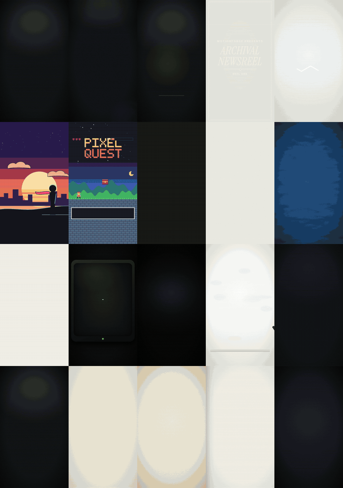

<div align="center">

# motionforge

**Videos de motion design escritos en código por tu agente de programación.**

Describe el video. Tu agente escribe el gancho y el guion, sincroniza cada palabra con la locución, construye escenas en 2D y 3D, renderiza y revisa su propio trabajo antes de que tú lo veas.

[English](../../README.md) · [Türkçe](README.tr.md) · [Español](README.es.md) · [Português (BR)](README.pt-BR.md) · [Français](README.fr.md) · [Deutsch](README.de.md) · [简体中文](README.zh-CN.md) · [日本語](README.ja.md) · [한국어](README.ko.md) · [हिन्दी](README.hi.md)

    


</div>

---

## Lo más destacado

| | |
|---|---|
| **100 estilos en 20 categorías** | Creadores, e-commerce, inmobiliaria, fútbol, documental, educación, tecnología, finanzas, gastronomía, fitness, viajes, eventos, noticias, empresas, videojuegos, infantil, moda, automoción, dirección de arte y ONG. Cada estilo es una especificación completa: paleta, tipografía, maquetación, movimiento, ritmo de montaje, sonido y escenas características. |
| **Escenas 3D con three.js** | Productos sobre una plataforma giratoria, un globo con arcos de vuelo, una ciudad con anillos de distancia a pie, una casa que se construye sola, una pizarra táctica de fútbol, gráficos 3D. Deterministas, precisas al fotograma y renderizadas sin conexión. |
| **Personajes y avatares que hablan** | Un presentador 3D construido con código, o tu foto o ilustración convertida en una marioneta que habla. La boca sigue la locución. Gratis y local por defecto. Si conectas una clave, también puedes usar modelos de lip-sync de fal.ai, Wiro o locales. |
| **Del guion a la entrega** | Ganchos y guiones con listas de frases prohibidas en 10 idiomas, sincronización palabra por palabra, subtítulos, sonoridad, hojas de contacto y un crítico independiente antes de entregar nada. |
| **Nada de pago sin tu sí** | Cada llamada de pago (voz, video, lip-sync) muestra primero qué va a generar y el costo estimado, y luego espera. Las claves salen solo de tu entorno. |

## Cómo funciona

Escribes algo como:

> Haz un reel de 45 segundos para mi cuenta inmobiliaria sobre este departamento. Mapa del barrio, plano 3D, mi voz y subtítulos.

motionforge lo convierte en un MP4 revisado a través de etapas fijas:

| Etapa | Qué pasa |
|---|---|
| **Brief** | El agente resume tu pedido en una frase y solo pregunta lo que falta (formato, duración, idioma, voz). |
| **Gancho y guion** | 2–3 opciones de gancho, un guion con ritmo pensado para decirse en voz alta y una lista de afirmaciones para que las verifiques. Sin estadísticas inventadas ni "frases de IA" de manual. |
| **Voz** | Tu propia grabación, un modelo TTS local o un TTS de pago con tu clave, después de que apruebes el costo. |
| **Sincronización** | Marcas de tiempo por palabra, para que cada título, logo y subtítulo aparezca justo en la palabra que se dice. |
| **Estilo y marca** | Un estilo de la biblioteca más tu `brand.json` (colores, tipografías, logo, marca de agua, cierre). |
| **Escenas** | Código determinista en el que puedes saltar a cualquier fotograma: HyperFrames (HTML + GSAP, con three.js para 3D) por defecto; Remotion o un motor canvas cuando encajan mejor. |
| **QA** | Hojas de contacto, comprobación de texto desbordado y zonas seguras, tiempo de lectura, sonoridad, desfase del lip-sync y un crítico con contexto limpio que nunca vio el proceso. |
| **Entrega** | MP4 en 9:16 / 1:1 / 16:9, una imagen de portada, subtítulos y la descripción de la publicación. Cambios por marca de tiempo: "cambia el título en 0:12". |

## Biblioteca de estilos

<p align="center"></p>

100 estilos visuales, agrupados según el tipo de cuenta que los usa. Algunos por categoría:

| Categoría | Estilos (ejemplos) |
|---|---|
| Creadores y marcas personales | `creator-reels-dark`, `talking-head-pop`, `podcast-clip-studio`, `vlog-film-diary`, `cinematic-quote` |
| E-commerce y productos | `product-hero-turntable`, `flash-sale`, `unboxing-pop`, `ugc-testimonial`, `before-after-split` |
| Inmobiliaria y mapas | `map-flyover-pins`, `floorplan-draw-on`, `neighborhood-guide`, `listing-tour-cards`, `luxury-estate` |
| Fútbol y deportes | `matchday-graphics`, `tactics-board`, `player-stat-card`, `transfer-breaking`, `telestrator-replay` |
| Documental y narrativa | `archival-newsreel`, `true-crime-board`, `history-map-campaign`, `interview-doc`, `cosmos-scale` |
| Educación, tecnología, finanzas, noticias, gastronomía, viajes, eventos, moda… | consulta el catálogo completo |

Catálogo completo con una línea por estilo: [skills/style-library/styles/README.md](../../skills/style-library/styles/README.md).

## Escenas 3D

<p align="center"></p>

Una capa de three.js para el motor HyperFrames. El lienzo 3D queda debajo del texto HTML, cada fotograma se calcula solo a partir del tiempo (sin reloj ni azar) y todo se renderiza sin conexión en Chrome headless. Usa tu propio modelo GLB o los objetos procedurales incluidos. Detalles: [engines/hyperframes/three](../../engines/hyperframes/three/README.md).

| Plantilla | Úsala para |
|---|---|
| `product-turntable-3d` | lanzamientos de producto, especificaciones señaladas sobre un pedestal iluminado |
| `globe-arcs-3d` | rutas de viaje, equipos internacionales, historia y noticias |
| `city-pin-3d` | ubicación de una propiedad, servicios cercanos y tiempos a pie |
| `house-build-3d` | anuncios, reformas, superficie por habitación |
| `pitch-tactics-3d` | análisis de fútbol: desmarques, pases, zonas de presión |
| `bars-3d` | crecimiento y comparativas, con la fuente en pantalla |

## Videos sin rostro y UGC

<p align="center"></p>

Para creadores que no quieren salir en cámara y marcas que hacen anuncios estilo UGC. La skill [`faceless-ugc`](../../skills/faceless-ugc/SKILL.md) ofrece cuatro caminos:

| Camino | Qué obtienes | Costo |
|---|---|---|
| **Sin rostro** | subtítulos cinéticos, b-roll, grabaciones de pantalla, formatos solo con manos o solo con producto | gratis |
| **Personaje 3D** | `character-3d`: un presentador construido con código con cinco presets (creador, profesor, chef, coach, analista), con parpadeos, gestos y expresiones en cada marca | gratis |
| **Avatar desde foto** | `photo-avatar`: tu foto o ilustración como marioneta 2.5D: mandíbula, interior de la boca, balanceo de cabeza, respiración, parpadeos | gratis |
| **Avatar con IA** | imagen a video y lip-sync con fal.ai, Wiro o un modelo de lip-sync en tu propia GPU (`tools/avatar`) | de pago, tras una estimación en modo de prueba (dry-run) y tu aprobación |

El movimiento de la boca sale de la locución (`tools/mouth_curve.py`), y todos los caminos terminan con una comprobación del desfase del lip-sync (`tools/avatar/sync_check.py`). Los avatares de personas reales requieren su consentimiento, y los presentadores de IA en anuncios se indican como tales.

## Instalación

### Claude Code (plugin)

```text
/plugin marketplace add aykutucesai/motionforge
/plugin install motionforge@motionforge
```

Después pide un video. La skill `motion-director` se encarga del resto.

### Codex, Cursor y otros agentes

```bash
git clone https://github.com/aykutucesai/motionforge
```

Indica al agente que lea [`AGENTS.md`](../../AGENTS.md). Cada skill es Markdown plano con comandos exactos, así que cualquier agente que pueda leer archivos y ejecutar una shell puede seguirla.

### Requisitos

- Node.js 18+ (se recomienda 22) y ffmpeg
- Python 3.10+ con numpy
- Opcional: `faster-whisper` (tiempos por palabra), `rembg` (recortes), `fonttools` (comprobación de glifos), `mediapipe` (puntos faciales), `fal-client` (fal.ai), Playwright Chromium

El agente los comprueba al inicio de cada trabajo y te dice exactamente qué instalar.

## Prueba estos prompts

```text
Convierte esta locución (voice.mp3) en un reel 9:16. Subtítulos cinéticos, estilo oscuro y logos reales de cada producto que menciono.
```
```text
Haz un video de producto de 30 segundos para este altavoz, con una plataforma giratoria 3D y tres especificaciones destacadas. Usa mi kit de marca.
```
```text
Explica este contraataque en un campo 3D: tres pases, un desmarque y luego el gol. Estilo día de partido.
```
```text
No quiero mostrar mi cara. Crea un presentador 3D con lentes y una sudadera verde que lea este guion.
```
```text
Escribe 3 opciones de gancho y un guion de 70 segundos en español sobre cómo ahorrar dinero en software. Todavía no generes audio.
```

## Qué incluye

```
motionforge/
├─ AGENTS.md                 punto de entrada para cualquier agente
├─ skills/
│  ├─ motion-director/       el flujo completo y sus puntos de aprobación
│  ├─ script-and-hooks/      ganchos, guiones, lista de afirmaciones, frases prohibidas (10 idiomas)
│  ├─ voice-and-timing/      TTS con consentimiento previo, tiempos por palabra, subtítulos, sonoridad
│  ├─ style-library/         100 estilos en 20 categorías, un STYLE.md cada uno
│  ├─ brand-kit/             brand.json: colores, tipografías, logos, marca de agua, cierre
│  ├─ faceless-ugc/          formatos sin rostro, personajes, avatares, lip-sync, formatos de anuncio UGC
│  └─ qa-review/             comprobaciones + crítico independiente
├─ engines/
│  ├─ hyperframes/           motor por defecto (HTML + GSAP, Apache-2.0)
│  │  └─ three/              capa 3D: escenario, luces, órbita, etiquetas que siguen puntos 3D
│  ├─ remotion/              motor React opcional + kit
│  └─ canvas/                páginas fotograma = f(t) para estilos dibujados a mano y procedurales
├─ templates/                16 escenas listas: 8 en 2D, 6 en 3D, character-3d, photo-avatar
├─ examples/styles/          las escenas detrás de las vistas previas de estilos
└─ tools/                    tiempos por palabra, curva de boca, CLI de avatar, comprobación de sync, recortes,
                             sonoridad, hoja de contactos, comprobación de texto, exportación, zona segura de portada
```

Todas las plantillas en movimiento: [templates/README.md](../../templates/README.md).

## Principios

1. **Gratis por defecto.** El motor por defecto, HyperFrames, es Apache-2.0; three.js es MIT. Remotion y las API de pago son opcionales (ver [Licencias](../LICENSING.md)).
2. **Determinista.** Cada fotograma es una función del tiempo. Misma entrada, mismo video.
3. **Nada de pago sin consentimiento.** El agente dice primero el costo y espera.
4. **Contenido honesto.** Las afirmaciones que necesitan fuente se listan para ti; las pantallas simuladas, los datos de ejemplo y los presentadores de IA se indican como tales.
5. **Revisado antes de entregar.** Si QA tiene un fallo abierto, el video no se entrega.

## Idiomas

Las instrucciones de las skills están escritas en inglés, pensadas para agentes. El agente te habla en tu idioma y escribe guiones, subtítulos y textos en pantalla en el idioma del video. Los patrones de gancho y las listas de frases prohibidas están escritos de forma nativa en:

English · Türkçe · Español · Português (Brasil) · Français · Deutsch · 简体中文 · 日本語 · 한국어 · हिन्दी

## Licencias

motionforge se publica bajo la [Licencia MIT](../../LICENSE). Usa herramientas de terceros que mantienen sus propias licencias; consulta [THIRD_PARTY.md](../../THIRD_PARTY.md) y la guía en lenguaje sencillo de [docs/LICENSING.md](../LICENSING.md). En resumen: HyperFrames es Apache-2.0; three.js es MIT; GSAP se instala desde npm con su propia licencia; Remotion es gratis para particulares y empresas de hasta 3 empleados, y por encima de eso requiere una licencia de empresa. Los datos de mapas vienen de Natural Earth (dominio público) y OpenStreetMap (ODbL, requiere atribución).

## Contribuir

Los issues y pull requests son bienvenidos: nuevos estilos, plantillas, escenas 3D, listas de idiomas, mejoras de los motores. Lee primero [CONTRIBUTING.md](../../CONTRIBUTING.md).

---

<div align="center">

Hecho por <a href="https://www.instagram.com/aykutucesai/">Aykut Üçeş</a> · <a href="https://x.com/Aykutuces">@Aykutuces</a>

</div>
