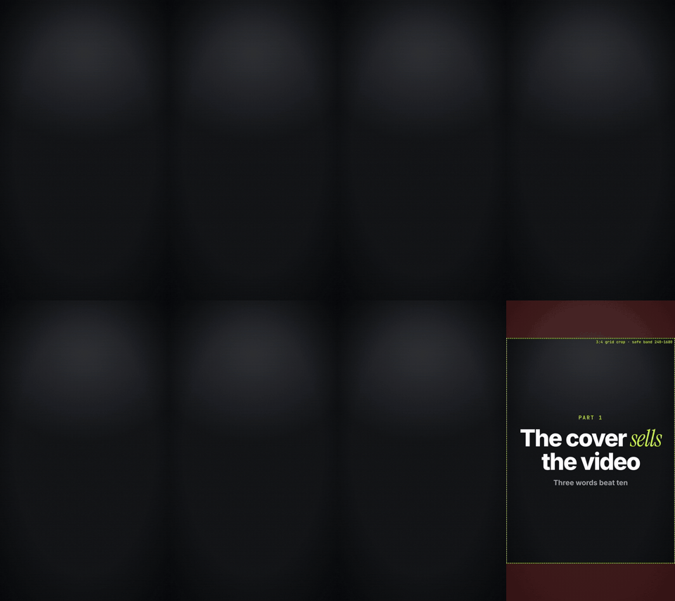

<div align="center">

# motionforge

**Des vidéos de motion design, écrites en code par votre agent de programmation.**

Décrivez la vidéo. Votre agent écrit l'accroche et le script, cale chaque mot sur la voix off, construit les scènes, lance le rendu et vérifie son propre travail avant de vous le montrer.

[English](../../README.md) · [Türkçe](README.tr.md) · [Español](README.es.md) · [Português (BR)](README.pt-BR.md) · [Français](README.fr.md) · [Deutsch](README.de.md) · [简体中文](README.zh-CN.md) · [日本語](README.ja.md) · [한국어](README.ko.md) · [हिन्दी](README.hi.md)

   

</div>

<p align="center"></p>

---

## Ce que fait motionforge

Vous tapez par exemple :

> Faites un reel vertical de 60 secondes sur les 5 outils gratuits que j'utilise tous les jours. Style sombre, ma voix, sous-titres.

motionforge en fait un MP4 vérifié, en suivant une série d'étapes fixes :

| Étape | Ce qui se passe |
|---|---|
| **Brief** | L'agent reformule votre demande en une phrase et ne pose de questions que sur ce qui manque (format, durée, langue, voix). |
| **Accroche et script** | 2 à 3 accroches au choix, un script rythmé pour être dit à voix haute et la liste des affirmations factuelles à vérifier. Aucune statistique inventée. Aucune « formule d'IA » toute faite (listes de formules interdites en 10 langues). |
| **Voix** | Utilisez votre propre clé TTS (ElevenLabs, OpenAI) ou un modèle local. L'agent annonce le coût et attend votre « oui » avant tout appel payant. |
| **Synchronisation** | Horodatage mot par mot à partir de la voix off : chaque titre, logo et sous-titre apparaît au moment où le mot est prononcé. |
| **Style et marque** | Choisissez un look dans la bibliothèque de styles et appliquez votre `brand.json` (couleurs, polices, logo, filigrane, outro). |
| **Scènes** | Construites en code déterministe, où l'on peut se placer à n'importe quel instant : HyperFrames (HTML + GSAP) par défaut, Remotion ou un moteur canvas quand ils conviennent mieux. |
| **QA** | Planches contact, contrôle des débordements de texte et des zones de sécurité, temps de lecture à l'écran, loudness, et un relecteur critique au contexte vierge qui n'a pas écrit les scènes. |
| **Livraison** | MP4 en 9:16 / 1:1 / 16:9, une image de couverture, des sous-titres et un texte de publication. Retouches par timecode : « changez le titre à 0:12 ». |

## Installation

### Claude Code (plugin)

```text
/plugin marketplace add aykutucesai/motionforge
/plugin install motionforge@motionforge
```

Ensuite, demandez simplement une vidéo. La skill `motion-director` prend le relais.

### Codex, Cursor et autres agents

```bash
git clone https://github.com/aykutucesai/motionforge
```

Ouvrez le dossier (ou ajoutez-le à votre projet) et indiquez à l'agent le fichier [`AGENTS.md`](../../AGENTS.md). Chaque skill est un simple fichier Markdown avec des commandes exactes : tout agent capable de lire des fichiers et d'exécuter des commandes shell peut la suivre.

### Prérequis

- Node.js 18+ (22 recommandé) et ffmpeg
- Python 3.10+
- Optionnel : `faster-whisper` (horodatage des mots), `rembg` (détourage d'une personne face caméra), `fonttools` (vérification des glyphes), Playwright Chromium

L'agent vérifie tout cela au début de chaque tâche et vous indique précisément quoi installer.

## Essayez ces prompts

```text
Transformez cette voix off (voice.mp3) en reel 9:16. Sous-titres animés, style sombre, vrais logos pour chaque produit que je cite.
```
```text
Faites un clip de lancement de 30 secondes pour mon app à partir de ces 4 captures d'écran. Utilisez mon kit de marque.
```
```text
Écrivez 3 accroches et un script de 70 secondes en espagnol sur les économies possibles sur les logiciels. Ne générez pas encore l'audio.
```
```text
Voici un clip de 10 secondes où l'on me voit à mon bureau. Utilisez les 5 premières secondes en intro et les 5 dernières en outro, avec des graphismes entre les deux.
```

## Contenu du dépôt

```
motionforge/
├─ AGENTS.md                 point d'entrée pour tout agent
├─ skills/
│  ├─ motion-director/       le workflow complet et ses étapes de validation
│  ├─ script-and-hooks/      accroches, scripts, liste d'affirmations, formules interdites (10 langues)
│  ├─ voice-and-timing/      TTS soumis à votre accord, timings des mots, sous-titres, loudness
│  ├─ style-library/         20 looks, un STYLE.md pour chacun
│  ├─ brand-kit/             brand.json : couleurs, polices, logos, filigrane, outro
│  └─ qa-review/             contrôles + relecteur critique indépendant
├─ engines/
│  ├─ hyperframes/           moteur par défaut (HTML + GSAP, Apache-2.0)
│  ├─ remotion/              moteur React optionnel + kit
│  └─ canvas/                pages frame = f(t) pour les looks dessinés à la main et procéduraux
├─ templates/                scènes prêtes à l'emploi : titre animé, sous-titres, compteur, navigateur, téléphone, chat, checklist, couverture
└─ tools/                    timings des mots, détourage, loudness, planche contact, contrôle du texte, export, zone de sécurité de la couverture
```

## Principes

1. **Gratuit pour tous par défaut.** Le moteur par défaut, HyperFrames, est sous licence Apache-2.0. Remotion est optionnel (voir [Licences](../LICENSING.md)).
2. **Déterministe.** Chaque image est une fonction du temps. Même entrée, même vidéo.
3. **Rien de payant sans votre accord.** L'agent annonce d'abord le coût.
4. **Contenu honnête.** Les affirmations qui demandent une source sont listées pour vous ; les écrans fictifs sont signalés comme tels.
5. **Vérifié avant livraison.** Tant que la QA signale un échec non résolu, la vidéo n'est pas livrée.

## Langues

Les instructions des skills sont rédigées en anglais, à l'intention des agents. L'agent vous parle dans votre langue et écrit les scripts, les sous-titres et les textes à l'écran dans la langue de la vidéo. Les modèles d'accroches et les listes de formules interdites sont rédigés directement dans chacune de ces langues :

English · Türkçe · Español · Português (Brasil) · Français · Deutsch · 简体中文 · 日本語 · 한국어 · हिन्दी

## Licences

motionforge est publié sous [licence MIT](../../LICENSE). Il fait appel à des outils tiers qui conservent leurs propres licences ; voir [THIRD_PARTY.md](../../THIRD_PARTY.md) et le guide en langage clair [docs/LICENSING.md](../LICENSING.md). En bref : HyperFrames est sous Apache-2.0 ; GSAP s'installe depuis npm sous sa propre licence ; Remotion est gratuit pour les particuliers et les entreprises de 3 salariés maximum, et demande une licence entreprise au-delà.

## Contribuer

Les issues et pull requests sont les bienvenues : nouveaux styles, templates, listes de langues, améliorations des moteurs. Lisez d'abord [CONTRIBUTING.md](../../CONTRIBUTING.md).

---

<div align="center">

Made by <a href="https://www.instagram.com/aykutucesai/">Aykut Üçeş</a> · <a href="https://x.com/Aykutuces">@Aykutuces</a>

</div>
