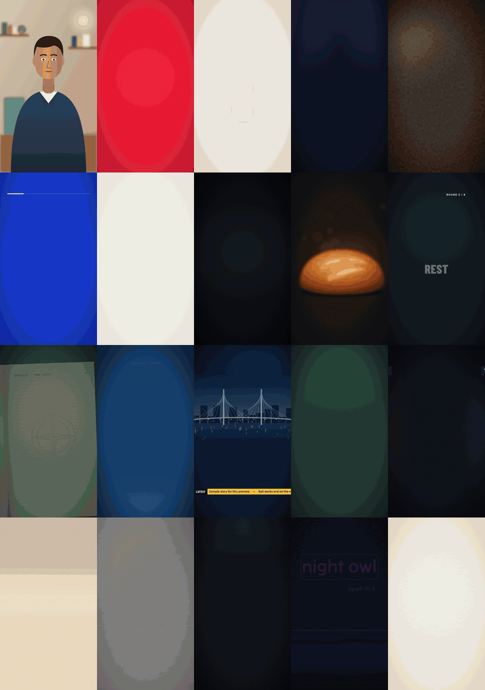

<div align="center">

# motionforge

**코딩 에이전트가 코드로 만드는 모션 디자인 영상.**

만들고 싶은 영상을 설명하세요. 에이전트가 훅과 대본을 쓰고, 내레이션에 맞춰 단어마다 타이밍을 잡고, 2D·3D 장면을 만들고, 렌더링한 뒤, 보여 드리기 전에 직접 결과물을 검수합니다.

[English](../../README.md) · [Türkçe](README.tr.md) · [Español](README.es.md) · [Português (BR)](README.pt-BR.md) · [Français](README.fr.md) · [Deutsch](README.de.md) · [简体中文](README.zh-CN.md) · [日本語](README.ja.md) · [한국어](README.ko.md) · [हिन्दी](README.hi.md)

    


</div>

---

## 주요 기능

| | |
|---|---|
| **20개 카테고리, 100가지 스타일** | 크리에이터, 이커머스, 부동산, 축구, 다큐멘터리, 교육, 테크, 금융, 푸드, 피트니스, 여행, 이벤트, 뉴스, 비즈니스, 게임, 키즈, 패션, 자동차, 아트 디렉션, 비영리. 각 스타일은 팔레트, 서체, 레이아웃, 모션, 편집 리듬, 사운드, 대표 장면까지 담은 완전한 명세입니다. |
| **three.js 기반 3D 장면** | 제품 턴테이블, 비행 경로가 호로 그려지는 지구본, 도보 거리 원이 표시된 도시, 스스로 지어지는 집, 축구 전술 피치, 3D 차트. 결정론적이고 프레임 단위로 정확하며, 오프라인으로 렌더링합니다. |
| **말하는 캐릭터와 아바타** | 코드로 만든 3D 진행자, 또는 내 사진이나 일러스트를 말하는 퍼펫으로. 입 모양이 내레이션을 따라갑니다. 기본은 무료이며 로컬에서 동작합니다. 키를 연결하면 fal.ai, Wiro 또는 로컬 립싱크 모델도 쓸 수 있습니다. |
| **대본부터 납품까지** | 10개 언어 금지 표현 목록을 반영한 훅과 대본, 단어 단위 타이밍, 자막, 라우드니스, 콘택트 시트, 그리고 납품 전 독립 검토자. |
| **동의 없이는 유료 작업 없음** | 모든 유료 호출(음성, 영상, 립싱크)은 무엇을 생성할지와 예상 비용을 먼저 보여 주고 기다립니다. 키는 환경 변수에서만 읽습니다. |

## 작동 방식

예를 들어 이렇게 입력합니다:

> 내 부동산 계정용으로 이 아파트를 소개하는 45초 릴스를 만들어 줘. 동네 지도, 3D 평면도, 내 목소리, 자막 포함.

motionforge는 정해진 단계를 거쳐 이를 검수된 MP4로 만듭니다:

| 단계 | 하는 일 |
|---|---|
| **브리프** | 에이전트가 요청을 한 문장으로 확인하고, 빠진 것(포맷, 길이, 언어, 음성)만 묻습니다. |
| **훅과 대본** | 훅 2–3개 안, 말하는 속도에 맞춘 대본, 직접 확인해야 할 사실 주장 목록. 지어낸 통계도, 뻔한 "AI 말투"도 없습니다. |
| **음성** | 직접 녹음한 음성, 로컬 TTS 모델, 또는 비용을 승인한 뒤 내 키로 쓰는 유료 TTS. |
| **타이밍** | 단어 단위 타임스탬프로 모든 제목, 로고, 자막이 해당 단어가 말해지는 순간에 맞춰 나옵니다. |
| **스타일과 브랜드** | 라이브러리의 스타일에 내 `brand.json`(색상, 폰트, 로고, 워터마크, 아웃트로)을 더합니다. |
| **장면** | 어느 프레임으로든 이동할 수 있는 결정론적 코드: 기본은 HyperFrames(HTML + GSAP, 3D는 three.js), 더 적합할 때는 Remotion이나 canvas 엔진. |
| **QA** | 콘택트 시트, 텍스트 넘침과 세이프 영역 검사, 읽기 시간, 라우드니스, 립싱크 오차, 그리고 제작 과정을 본 적 없는 새 컨텍스트의 검토자. |
| **납품** | 9:16 / 1:1 / 16:9 MP4, 커버 이미지, 자막, 게시물 설명. 수정은 타임스탬프로: "0:12의 제목을 바꿔 줘". |

## 스타일 라이브러리

<p align="center"></p>

사용하는 계정 유형별로 묶은 100가지 룩. 카테고리마다 몇 가지씩 소개합니다:

| 카테고리 | 스타일(예시) |
|---|---|
| 크리에이터·퍼스널 브랜드 | `creator-reels-dark`, `talking-head-pop`, `podcast-clip-studio`, `vlog-film-diary`, `cinematic-quote` |
| 이커머스·제품 | `product-hero-turntable`, `flash-sale`, `unboxing-pop`, `ugc-testimonial`, `before-after-split` |
| 부동산·지도 | `map-flyover-pins`, `floorplan-draw-on`, `neighborhood-guide`, `listing-tour-cards`, `luxury-estate` |
| 축구·스포츠 | `matchday-graphics`, `tactics-board`, `player-stat-card`, `transfer-breaking`, `telestrator-replay` |
| 다큐멘터리·스토리텔링 | `archival-newsreel`, `true-crime-board`, `history-map-campaign`, `interview-doc`, `cosmos-scale` |
| 교육, 테크, 금융, 뉴스, 푸드, 여행, 이벤트, 패션… | 전체 카탈로그 참고 |

스타일마다 한 줄 설명이 달린 전체 카탈로그: [skills/style-library/styles/README.md](../../skills/style-library/styles/README.md).

## 3D 장면

<p align="center"></p>

HyperFrames 엔진용 three.js 레이어입니다. 3D 캔버스는 HTML 텍스트 아래에 놓이고, 모든 프레임은 시간만으로 계산되며(시계도 난수도 쓰지 않음), 전부 헤드리스 Chrome에서 오프라인으로 렌더링됩니다. 가지고 있는 GLB 모델을 쓰거나 내장된 절차적 오브젝트를 사용하세요. 자세한 내용: [engines/hyperframes/three](../../engines/hyperframes/three/README.md).

| 템플릿 | 용도 |
|---|---|
| `product-turntable-3d` | 제품 출시, 조명을 받은 받침대 위 스펙 표시 |
| `globe-arcs-3d` | 여행 경로, 글로벌 팀, 역사와 뉴스 |
| `city-pin-3d` | 매물 위치, 주변 편의시설, 도보 시간 |
| `house-build-3d` | 매물 소개, 리모델링, 방별 면적 |
| `pitch-tactics-3d` | 축구 분석: 침투, 패스, 압박 구역 |
| `bars-3d` | 성장과 비교, 출처를 화면에 표시 |

## 얼굴 없는 영상과 UGC 영상

<p align="center"></p>

카메라 앞에 서고 싶지 않은 크리에이터와 UGC 스타일 광고를 만드는 브랜드를 위한 기능입니다. [`faceless-ugc`](../../skills/faceless-ugc/SKILL.md) 스킬은 네 가지 방식을 제공합니다:

| 방식 | 결과물 | 비용 |
|---|---|---|
| **얼굴 없음** | 키네틱 자막, B롤, 화면 녹화, 손만 또는 제품만 나오는 포맷 | 무료 |
| **3D 캐릭터** | `character-3d`: 코드로 만든 진행자. 다섯 가지 프리셋(크리에이터, 선생님, 셰프, 코치, 애널리스트), 큐에 맞춘 눈 깜빡임, 제스처, 표정 | 무료 |
| **사진 아바타** | `photo-avatar`: 내 사진이나 일러스트를 2.5D 퍼펫으로: 턱, 입 안쪽, 고개 흔들림, 호흡, 눈 깜빡임 | 무료 |
| **AI 아바타** | fal.ai, Wiro 또는 내 GPU에서 돌리는 립싱크 모델로 이미지→영상 생성과 립싱크(`tools/avatar`) | 유료, 드라이런 비용 견적과 승인 후 진행 |

입 모양은 내레이션에서 계산되고(`tools/mouth_curve.py`), 모든 방식은 립싱크 오차 검사로 끝납니다(`tools/avatar/sync_check.py`). 실존 인물의 아바타에는 본인의 동의가 필요하며, 광고 속 AI 진행자는 그 사실을 밝힙니다.

## 설치

### Claude Code (플러그인)

```text
/plugin marketplace add aykutucesai/motionforge
/plugin install motionforge@motionforge
```

그다음 영상을 요청하면 `motion-director` 스킬이 이어받습니다.

### Codex, Cursor 등 다른 에이전트

```bash
git clone https://github.com/aykutucesai/motionforge
```

에이전트에게 [`AGENTS.md`](../../AGENTS.md)를 알려 주세요. 모든 스킬은 정확한 명령어가 담긴 일반 Markdown이라, 파일을 읽고 셸을 실행할 수 있는 에이전트라면 그대로 따라 할 수 있습니다.

### 요구 사항

- Node.js 18+ (22 권장)와 ffmpeg
- numpy가 설치된 Python 3.10+
- 선택: `faster-whisper`(단어 타이밍), `rembg`(누끼), `fonttools`(글리프 검사), `mediapipe`(얼굴 랜드마크), `fal-client`(fal.ai), Playwright Chromium

에이전트가 작업을 시작할 때 이를 확인하고 무엇을 설치해야 하는지 정확히 알려 줍니다.

## 이런 프롬프트를 써 보세요

```text
이 내레이션(voice.mp3)을 9:16 릴스로 만들어 줘. 키네틱 자막, 다크 스타일, 내가 언급하는 모든 제품에는 실제 로고를 넣어 줘.
```
```text
이 스피커로 30초 제품 영상을 만들어 줘. 3D 턴테이블과 스펙 표시 세 개. 내 브랜드 키트를 써 줘.
```
```text
이 역습을 3D 피치에서 설명해 줘: 패스 세 번, 침투 한 번, 그리고 골. 매치데이 스타일로.
```
```text
얼굴은 보여 주고 싶지 않아. 안경을 쓰고 초록색 후드티를 입은 3D 진행자를 만들어서 이 대본을 읽게 해 줘.
```
```text
소프트웨어 비용 절약에 관해 스페인어로 훅 3개와 70초 대본을 써 줘. 오디오는 아직 만들지 마.
```

## 구성

```
motionforge/
├─ AGENTS.md                 모든 에이전트의 시작점
├─ skills/
│  ├─ motion-director/       전체 워크플로와 승인 단계
│  ├─ script-and-hooks/      훅, 대본, 주장 목록, 금지 표현(10개 언어)
│  ├─ voice-and-timing/      동의 기반 TTS, 단어 타이밍, 자막, 라우드니스
│  ├─ style-library/         20개 카테고리 100가지 스타일, 각각 STYLE.md 하나
│  ├─ brand-kit/             brand.json: 색상, 폰트, 로고, 워터마크, 아웃트로
│  ├─ faceless-ugc/          얼굴 없는 포맷, 캐릭터, 아바타, 립싱크, UGC 광고 포맷
│  └─ qa-review/             검사 + 독립 검토자
├─ engines/
│  ├─ hyperframes/           기본 엔진(HTML + GSAP, Apache-2.0)
│  │  └─ three/              3D 레이어: 스테이지, 조명, 궤도 카메라, 3D 지점을 따라가는 라벨
│  ├─ remotion/              선택형 React 엔진 + 키트
│  └─ canvas/                손그림·절차적 룩을 위한 frame = f(t) 페이지
├─ templates/                바로 쓰는 장면 16개: 2D 8개, 3D 6개, character-3d, photo-avatar
├─ examples/styles/          스타일 미리보기에 쓰인 장면
└─ tools/                    단어 타이밍, 입 모양 곡선, 아바타 CLI, 싱크 검사, 누끼,
                             라우드니스, 콘택트 시트, 텍스트 검사, 내보내기, 커버 세이프 영역
```

모든 템플릿 애니메이션: [templates/README.md](../../templates/README.md).

## 원칙

1. **기본은 무료.** 기본 엔진 HyperFrames는 Apache-2.0, three.js는 MIT입니다. Remotion과 유료 API는 선택 사항입니다([라이선스](../LICENSING.md) 참고).
2. **결정론적.** 모든 프레임은 시간의 함수입니다. 같은 입력이면 같은 영상이 나옵니다.
3. **동의 없이는 유료 작업 없음.** 에이전트가 먼저 비용을 알리고 기다립니다.
4. **정직한 콘텐츠.** 출처가 필요한 주장은 목록으로 정리해 드리고, 목업 화면, 예시 데이터, AI 진행자는 표시합니다.
5. **납품 전 검수.** QA에 해결되지 않은 실패 항목이 있으면 영상을 납품하지 않습니다.

## 언어

스킬 지침은 에이전트용으로 영어로 작성되어 있습니다. 에이전트는 사용자의 언어로 대화하고, 대본과 자막, 화면 텍스트는 영상의 언어로 씁니다. 훅 패턴과 금지 표현 목록은 다음 언어로 직접 작성되어 있습니다:

English · Türkçe · Español · Português (Brasil) · Français · Deutsch · 简体中文 · 日本語 · 한국어 · हिन्दी

## 라이선스

motionforge는 [MIT 라이선스](../../LICENSE)로 배포됩니다. 각자의 라이선스를 따르는 서드파티 도구를 호출하므로 [THIRD_PARTY.md](../../THIRD_PARTY.md)와 쉬운 말로 정리한 [docs/LICENSING.md](../LICENSING.md)를 참고하세요. 요약하면: HyperFrames는 Apache-2.0, three.js는 MIT이며, GSAP는 자체 라이선스로 npm에서 설치합니다. Remotion은 개인과 직원 3명 이하 회사에는 무료이고, 그보다 크면 회사 라이선스가 필요합니다. 지도 데이터는 Natural Earth(퍼블릭 도메인)와 OpenStreetMap(ODbL, 출처 표기 필요)에서 가져옵니다.

## 기여하기

이슈와 풀 리퀘스트를 환영합니다: 새 스타일, 템플릿, 3D 장면, 언어 목록, 엔진 개선 등. 먼저 [CONTRIBUTING.md](../../CONTRIBUTING.md)를 읽어 주세요.

---

<div align="center">

만든 사람: <a href="https://www.instagram.com/aykutucesai/">Aykut Üçeş</a> · <a href="https://x.com/Aykutuces">@Aykutuces</a>

</div>
