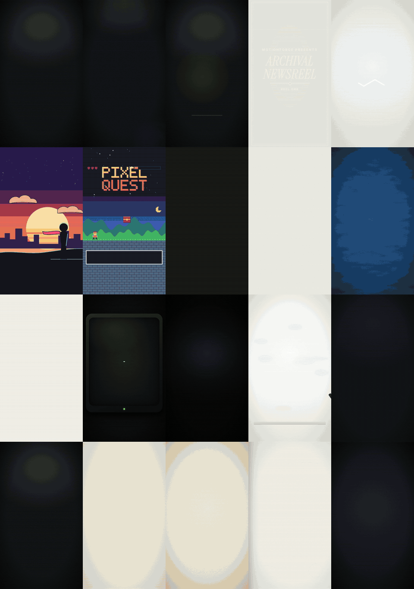

<div align="center">

# motionforge

**Vídeos de motion design escritos em código pelo seu agente de programação.**

Descreva o vídeo. Seu agente escreve o gancho e o roteiro, sincroniza cada palavra com a narração, monta cenas 2D e 3D, renderiza e revisa o próprio trabalho antes de você ver.

[English](../../README.md) · [Türkçe](README.tr.md) · [Español](README.es.md) · [Português (BR)](README.pt-BR.md) · [Français](README.fr.md) · [Deutsch](README.de.md) · [简体中文](README.zh-CN.md) · [日本語](README.ja.md) · [한국어](README.ko.md) · [हिन्दी](README.hi.md)

    


</div>

---

## Destaques

| | |
|---|---|
| **100 estilos em 20 categorias** | Criadores, e-commerce, imóveis, futebol, documentário, educação, tecnologia, finanças, gastronomia, fitness, viagem, eventos, notícias, negócios, games, infantil, moda, automotivo, direção de arte e ONGs. Cada estilo é uma especificação completa: paleta, tipografia, layout, movimento, ritmo de edição, som e cenas características. |
| **Cenas 3D com three.js** | Produtos girando em uma base, um globo com arcos de voo, uma cidade com anéis de distância a pé, uma casa que se constrói sozinha, um campo tático de futebol, gráficos 3D. Determinísticas, precisas no quadro e renderizadas offline. |
| **Personagens e avatares que falam** | Um apresentador 3D construído em código, ou sua foto ou ilustração como um boneco falante. A boca acompanha a narração. Gratuito e local por padrão. Se você conectar uma chave, pode usar também modelos de lip-sync da fal.ai, da Wiro ou locais. |
| **Do roteiro à entrega** | Ganchos e roteiros com listas de frases proibidas em 10 idiomas, tempo por palavra, legendas, loudness, folhas de contato e um crítico independente antes de qualquer entrega. |
| **Nada pago sem o seu sim** | Toda chamada paga (voz, vídeo, lip-sync) mostra primeiro o que vai gerar e o custo estimado, e então espera. As chaves vêm só do seu ambiente. |

## Como funciona

Você digita algo como:

> Faça um reel de 45 segundos para o meu perfil de imóveis sobre este apartamento. Mapa do bairro, planta 3D, minha voz e legendas.

O motionforge transforma isso em um MP4 revisado, passando por etapas fixas:

| Etapa | O que acontece |
|---|---|
| **Briefing** | O agente resume seu pedido em uma frase e pergunta só o que falta (formato, duração, idioma, voz). |
| **Gancho e roteiro** | 2–3 opções de gancho, um roteiro com ritmo de fala e uma lista de afirmações factuais para você verificar. Sem estatísticas inventadas, sem "frases de IA" prontas. |
| **Voz** | Sua própria gravação, um modelo de TTS local ou um TTS pago com a sua chave, depois que você aprovar o custo. |
| **Tempo** | Marcações de tempo por palavra, para que cada título, logo e legenda entre exatamente na palavra falada. |
| **Estilo e marca** | Um estilo da biblioteca mais o seu `brand.json` (cores, fontes, logo, marca d'água, encerramento). |
| **Cenas** | Código determinístico em que dá para pular para qualquer quadro: HyperFrames (HTML + GSAP, com three.js para 3D) por padrão; Remotion ou um motor canvas quando se encaixam melhor. |
| **QA** | Folhas de contato, checagem de texto estourado e área segura, tempo de leitura, loudness, atraso do lip-sync e um crítico com contexto limpo que nunca viu a produção. |
| **Entrega** | MP4 em 9:16 / 1:1 / 16:9, uma imagem de capa, legendas e a descrição do post. Ajustes por minutagem: "troque o título em 0:12". |

## Biblioteca de estilos

<p align="center"></p>

100 visuais, agrupados pelo tipo de perfil que os usa. Alguns por categoria:

| Categoria | Estilos (exemplos) |
|---|---|
| Criadores e marcas pessoais | `creator-reels-dark`, `talking-head-pop`, `podcast-clip-studio`, `vlog-film-diary`, `cinematic-quote` |
| E-commerce e produtos | `product-hero-turntable`, `flash-sale`, `unboxing-pop`, `ugc-testimonial`, `before-after-split` |
| Imóveis e mapas | `map-flyover-pins`, `floorplan-draw-on`, `neighborhood-guide`, `listing-tour-cards`, `luxury-estate` |
| Futebol e esportes | `matchday-graphics`, `tactics-board`, `player-stat-card`, `transfer-breaking`, `telestrator-replay` |
| Documentário e narrativa | `archival-newsreel`, `true-crime-board`, `history-map-campaign`, `interview-doc`, `cosmos-scale` |
| Educação, tecnologia, finanças, notícias, gastronomia, viagem, eventos, moda… | veja o catálogo completo |

Catálogo completo com uma linha por estilo: [skills/style-library/styles/README.md](../../skills/style-library/styles/README.md).

## Cenas 3D

<p align="center"></p>

Uma camada de three.js para o motor HyperFrames. O canvas 3D fica sob o texto HTML, cada quadro é calculado só a partir do tempo (sem relógio, sem aleatoriedade) e tudo é renderizado offline no Chrome headless. Traga seu próprio modelo GLB ou use os objetos procedurais incluídos. Detalhes: [engines/hyperframes/three](../../engines/hyperframes/three/README.md).

| Template | Use para |
|---|---|
| `product-turntable-3d` | lançamentos de produto, destaques de especificação em um pedestal iluminado |
| `globe-arcs-3d` | rotas de viagem, equipes globais, história e notícias |
| `city-pin-3d` | localização do imóvel, comodidades e tempo de caminhada |
| `house-build-3d` | anúncios de imóveis, reformas, metragem por cômodo |
| `pitch-tactics-3d` | análise de futebol: infiltrações, passes, zonas de pressão |
| `bars-3d` | crescimento e comparações, com a fonte na tela |

## Vídeos sem rosto e UGC

<p align="center"></p>

Para criadores que não querem aparecer na câmera e marcas que fazem anúncios no estilo UGC. A skill [`faceless-ugc`](../../skills/faceless-ugc/SKILL.md) oferece quatro caminhos:

| Caminho | O que você recebe | Custo |
|---|---|---|
| **Sem rosto** | legendas cinéticas, b-roll, gravações de tela, formatos só com mãos ou só com produto | grátis |
| **Personagem 3D** | `character-3d`: um apresentador construído em código com cinco presets (criador, professor, chef, coach, analista), com piscadas, gestos e expressões nas marcações | grátis |
| **Avatar de foto** | `photo-avatar`: sua foto ou ilustração como um boneco 2.5D: mandíbula, interior da boca, balanço da cabeça, respiração, piscadas | grátis |
| **Avatar de IA** | imagem para vídeo e lip-sync via fal.ai, Wiro ou um modelo de lip-sync na sua própria GPU (`tools/avatar`) | pago, depois de uma estimativa em dry-run e da sua aprovação |

O movimento da boca vem da narração (`tools/mouth_curve.py`), e todo caminho termina com uma checagem de atraso do lip-sync (`tools/avatar/sync_check.py`). Avatares de pessoas reais exigem o consentimento dessa pessoa, e apresentadores de IA em anúncios são sinalizados.

## Instalação

### Claude Code (plugin)

```text
/plugin marketplace add aykutucesai/motionforge
/plugin install motionforge@motionforge
```

Depois, peça um vídeo. A skill `motion-director` assume a partir daí.

### Codex, Cursor e outros agentes

```bash
git clone https://github.com/aykutucesai/motionforge
```

Aponte o agente para o [`AGENTS.md`](../../AGENTS.md). Cada skill é Markdown puro com comandos exatos, então qualquer agente que consiga ler arquivos e rodar um shell consegue segui-la.

### Requisitos

- Node.js 18+ (22 recomendado) e ffmpeg
- Python 3.10+ com numpy
- Opcional: `faster-whisper` (tempo por palavra), `rembg` (recortes), `fonttools` (checagem de glifos), `mediapipe` (pontos do rosto), `fal-client` (fal.ai), Playwright Chromium

O agente verifica isso no início de cada trabalho e diz exatamente o que instalar.

## Experimente estes prompts

```text
Transforme esta narração (voice.mp3) em um reel 9:16. Legendas cinéticas, estilo escuro e logos reais de cada produto que eu mencionar.
```
```text
Faça um vídeo de produto de 30 segundos para esta caixa de som, com uma base giratória 3D e três destaques de especificação. Use meu kit de marca.
```
```text
Explique este contra-ataque em um campo 3D: três passes, uma infiltração e depois o gol. Estilo dia de jogo.
```
```text
Não quero mostrar meu rosto. Crie um apresentador 3D de óculos e moletom verde que leia este roteiro.
```
```text
Escreva 3 opções de gancho e um roteiro de 70 segundos em espanhol sobre como economizar com software. Não gere o áudio ainda.
```

## O que tem dentro

```
motionforge/
├─ AGENTS.md                 ponto de entrada para qualquer agente
├─ skills/
│  ├─ motion-director/       o fluxo completo e seus pontos de aprovação
│  ├─ script-and-hooks/      ganchos, roteiros, lista de afirmações, frases proibidas (10 idiomas)
│  ├─ voice-and-timing/      TTS só com consentimento, tempo por palavra, legendas, loudness
│  ├─ style-library/         100 estilos em 20 categorias, um STYLE.md para cada
│  ├─ brand-kit/             brand.json: cores, fontes, logos, marca d'água, encerramento
│  ├─ faceless-ugc/          formatos sem rosto, personagens, avatares, lip-sync, formatos de anúncio UGC
│  └─ qa-review/             checagens + crítico independente
├─ engines/
│  ├─ hyperframes/           motor padrão (HTML + GSAP, Apache-2.0)
│  │  └─ three/              camada 3D: palco, luzes, órbita, rótulos que seguem pontos 3D
│  ├─ remotion/              motor React opcional + kit
│  └─ canvas/                páginas quadro = f(t) para visuais desenhados à mão e procedurais
├─ templates/                16 cenas prontas: 8 em 2D, 6 em 3D, character-3d, photo-avatar
├─ examples/styles/          as cenas por trás das prévias de estilo
└─ tools/                    tempo por palavra, curva da boca, CLI de avatar, checagem de sync, recortes,
                             loudness, folha de contato, checagem de texto, exportação, área segura da capa
```

Todos os templates em movimento: [templates/README.md](../../templates/README.md).

## Princípios

1. **Gratuito por padrão.** O motor padrão, HyperFrames, é Apache-2.0; three.js é MIT. Remotion e APIs pagas são opcionais (veja [Licenciamento](../LICENSING.md)).
2. **Determinístico.** Cada quadro é uma função do tempo. Mesma entrada, mesmo vídeo.
3. **Nada pago sem consentimento.** O agente informa o custo primeiro e espera.
4. **Conteúdo honesto.** Afirmações que precisam de fonte são listadas para você; telas simuladas, dados de exemplo e apresentadores de IA são sinalizados.
5. **Revisado antes da entrega.** Se o QA tiver uma falha em aberto, o vídeo não é entregue.

## Idiomas

As instruções das skills são escritas em inglês, para agentes. O agente conversa com você no seu idioma e escreve roteiros, legendas e textos na tela no idioma do vídeo. Os padrões de gancho e as listas de frases proibidas foram escritos nativamente em:

English · Türkçe · Español · Português (Brasil) · Français · Deutsch · 简体中文 · 日本語 · 한국어 · हिन्दी

## Licenciamento

O motionforge é distribuído sob a [Licença MIT](../../LICENSE). Ele chama ferramentas de terceiros que mantêm suas próprias licenças; veja [THIRD_PARTY.md](../../THIRD_PARTY.md) e o guia em linguagem simples em [docs/LICENSING.md](../LICENSING.md). Em resumo: HyperFrames é Apache-2.0; three.js é MIT; o GSAP é instalado pelo npm sob sua própria licença; o Remotion é gratuito para pessoas físicas e empresas com até 3 funcionários e exige licença empresarial acima disso. Os dados de mapa vêm do Natural Earth (domínio público) e do OpenStreetMap (ODbL, crédito obrigatório).

## Como contribuir

Issues e pull requests são bem-vindos: novos estilos, templates, cenas 3D, listas de idiomas, melhorias nos motores. Leia o [CONTRIBUTING.md](../../CONTRIBUTING.md) antes.

---

<div align="center">

Feito por <a href="https://www.instagram.com/aykutucesai/">Aykut Üçeş</a> · <a href="https://x.com/Aykutuces">@Aykutuces</a>

</div>
