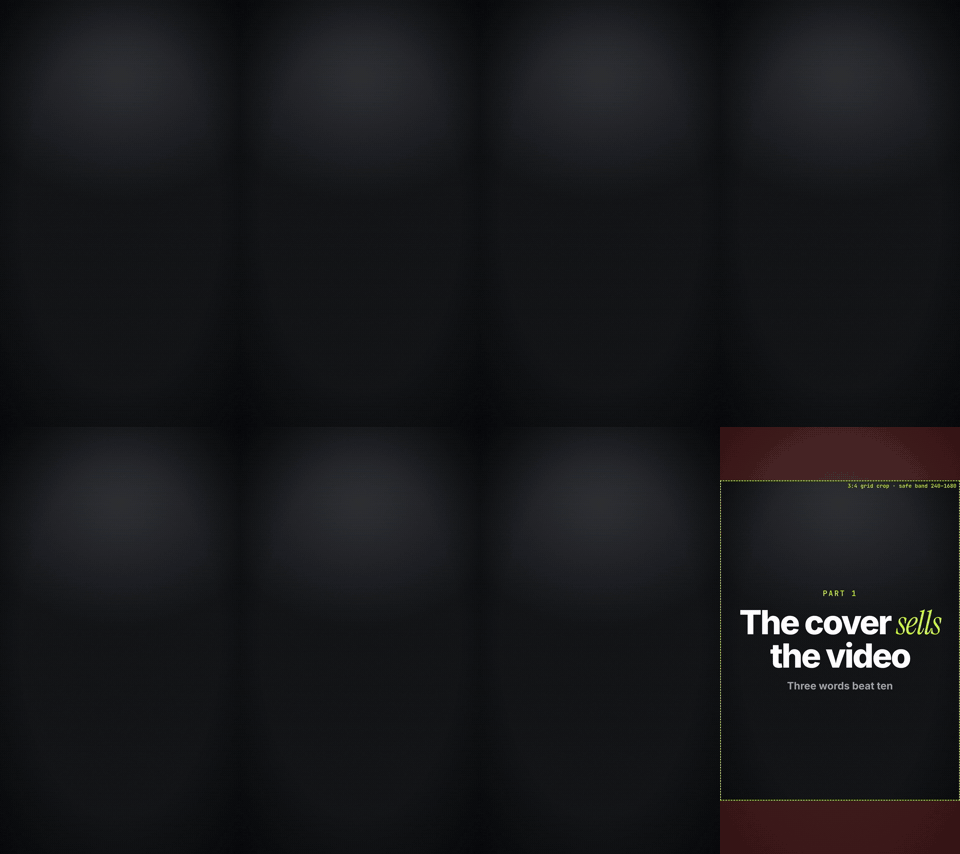

<div align="center">

# motionforge

**Kodlama ajanının kodla yazdığı motion design videoları.**

Videoyu anlat. Ajanın kancayı ve metni yazar, her kelimeyi seslendirmeye göre zamanlar, sahneleri kurar, render alır ve sana göstermeden önce kendi işini kontrol eder.

[English](../../README.md) · [Türkçe](README.tr.md) · [Español](README.es.md) · [Português (BR)](README.pt-BR.md) · [Français](README.fr.md) · [Deutsch](README.de.md) · [简体中文](README.zh-CN.md) · [日本語](README.ja.md) · [한국어](README.ko.md) · [हिन्दी](README.hi.md)

   

</div>

<p align="center"></p>

---

## Ne yapar

Şöyle bir şey yazarsın:

> Her gün kullandığım 5 ücretsiz araç hakkında 60 saniyelik dikey bir reel yap. Koyu stil, benim sesim, altyazılı.

motionforge bunu sabit aşamalardan geçirip kontrol edilmiş bir MP4'e dönüştürür:

| Aşama | Ne olur |
|---|---|
| **Brif** | Ajan isteğini tek cümleyle sana geri okur ve yalnızca eksik olanı sorar (format, süre, dil, ses). |
| **Kanca ve metin** | 2–3 kanca seçeneği, konuşma temposuna göre yazılmış bir metin ve doğrulaman gereken olgusal iddiaların listesi. Uydurma istatistik yok. Hazır "yapay zekâ kalıpları" yok (10 dilde yasaklı ifade listeleri). |
| **Ses** | Kendi TTS anahtarını kullan (ElevenLabs, OpenAI) ya da yerel bir model çalıştır. Ajan ücretli her çağrıdan önce maliyeti söyler ve "evet" demeni bekler. |
| **Zamanlama** | Seslendirmeden kelime düzeyinde zaman damgaları çıkarılır; böylece her başlık, logo ve altyazı tam o kelime söylenirken ekrana gelir. |
| **Stil ve marka** | Stil kütüphanesinden bir görünüm seç ve `brand.json` dosyanı uygula (renkler, fontlar, logo, filigran, kapanış). |
| **Sahneler** | İstenen ana atlanabilen, deterministik kod olarak kurulur: varsayılan olarak HyperFrames (HTML + GSAP), daha uygun olduğunda Remotion ya da bir canvas motoru. |
| **QA** | Kontak sayfaları, metin taşması ve güvenli alan kontrolleri, ekrandaki yazıların okunma süresi, ses yüksekliği ve sahneleri yazmamış, temiz bağlamla çalışan bağımsız bir eleştirmen. |
| **Teslim** | 9:16 / 1:1 / 16:9 MP4, kapak görseli, altyazılar ve paylaşım açıklaması. Revizyonlar zaman damgasıyla istenir: "0:12'deki başlığı değiştir". |

## Kurulum

### Claude Code (eklenti)

```text
/plugin marketplace add aykutucesai/motionforge
/plugin install motionforge@motionforge
```

Sonra bir video istemen yeterli. `motion-director` skill'i işi devralır.

### Codex, Cursor ve diğer ajanlar

```bash
git clone https://github.com/aykutucesai/motionforge
```

Klasörü aç (ya da projene ekle) ve ajanı [`AGENTS.md`](../../AGENTS.md) dosyasına yönlendir. Her skill, komutları birebir içeren düz bir Markdown dosyasıdır; dosya okuyup kabuk komutu çalıştırabilen her ajan adımları takip edebilir.

### Gereksinimler

- Node.js 18+ (22 önerilir) ve ffmpeg
- Python 3.10+
- İsteğe bağlı: `faster-whisper` (kelime zamanlamaları), `rembg` (konuşan kişiyi arka plandan ayırma), `fonttools` (glif kontrolleri), Playwright Chromium

Ajan bunları her işin başında kontrol eder ve neyi kurman gerektiğini açıkça söyler.

## Bu komutları dene

```text
Bu seslendirmeyi (voice.mp3) 9:16 bir reel'e dönüştür. Kinetik altyazılar, koyu stil, bahsettiğim her ürün için gerçek logolar.
```
```text
Bu 4 ekran görüntüsünden uygulamam için 30 saniyelik bir ürün lansman klibi yap. Marka kitimi kullan.
```
```text
Yazılım masraflarını azaltmak üzerine İspanyolca 3 kanca seçeneği ve 70 saniyelik bir metin yaz. Sesi henüz üretme.
```
```text
Bu, masamda çekilmiş 10 saniyelik bir klibim. İlk 5 saniyeyi giriş, son 5 saniyeyi kapanış olarak kullan, arada grafikler olsun.
```

## İçinde neler var

```
motionforge/
├─ AGENTS.md                 her ajan için giriş noktası
├─ skills/
│  ├─ motion-director/       tüm iş akışı ve onay adımları
│  ├─ script-and-hooks/      kancalar, metinler, iddia listesi, yasaklı ifadeler (10 dil)
│  ├─ voice-and-timing/      onaya bağlı TTS, kelime zamanlamaları, altyazılar, ses yüksekliği
│  ├─ style-library/         20 görünüm, her biri için bir STYLE.md
│  ├─ brand-kit/             brand.json: renkler, fontlar, logolar, filigran, kapanış
│  └─ qa-review/             kontroller + bağımsız eleştirmen
├─ engines/
│  ├─ hyperframes/           varsayılan motor (HTML + GSAP, Apache-2.0)
│  ├─ remotion/              isteğe bağlı React motoru + kit
│  └─ canvas/                elle çizilmiş ve prosedürel görünümler için frame = f(t) sayfaları
├─ templates/                hazır sahneler: kinetik başlık, altyazılar, sayaç, tarayıcı, telefon, sohbet, kontrol listesi, kapak
└─ tools/                    kelime zamanlamaları, arka plan ayırma, ses yüksekliği, kontak sayfası, metin kontrolü, dışa aktarma, kapak güvenli alanı
```

## İlkeler

1. **Varsayılan kurulum herkes için ücretsiz.** Varsayılan motor HyperFrames, Apache-2.0 lisanslıdır. Remotion isteğe bağlıdır (bkz. [Lisanslama](../LICENSING.md)).
2. **Deterministik.** Her kare zamanın bir fonksiyonudur. Aynı girdi, aynı video.
3. **Onayın olmadan ücretli hiçbir işlem yok.** Ajan önce maliyeti söyler.
4. **Dürüst içerik.** Kaynak gerektiren iddialar senin için listelenir; temsili ekranlar açıkça belirtilir.
5. **Teslimden önce kontrol.** QA'da çözülmemiş bir hata varsa video teslim edilmez.

## Diller

Skill talimatları ajanlar için İngilizce yazılmıştır. Ajan seninle kendi dilinde konuşur; metinleri, altyazıları ve ekran yazılarını videonun dilinde yazar. Kanca kalıpları ve yasaklı ifade listeleri çeviri değil, her dil için o dilde ayrı ayrı yazılmıştır:

English · Türkçe · Español · Português (Brasil) · Français · Deutsch · 简体中文 · 日本語 · 한국어 · हिन्दी

## Lisanslama

motionforge [MIT Lisansı](../../LICENSE) ile yayımlanır. Kendi lisanslarına tabi üçüncü taraf araçları çağırır; ayrıntılar için [THIRD_PARTY.md](../../THIRD_PARTY.md) dosyasına ve sade bir dille yazılmış [docs/LICENSING.md](../LICENSING.md) rehberine bak. Kısaca: HyperFrames Apache-2.0 lisanslıdır; GSAP npm'den kendi lisansıyla kurulur; Remotion bireyler ve en fazla 3 çalışanı olan şirketler için ücretsizdir, daha büyük şirketler için şirket lisansı gerekir.

## Katkıda bulunma

Issue ve pull request'lere açığız: yeni stiller, şablonlar, dil listeleri, motor iyileştirmeleri. Önce [CONTRIBUTING.md](../../CONTRIBUTING.md) dosyasını oku.

---

<div align="center">

Made by <a href="https://www.instagram.com/aykutucesai/">Aykut Üçeş</a> · <a href="https://x.com/Aykutuces">@Aykutuces</a>

</div>
