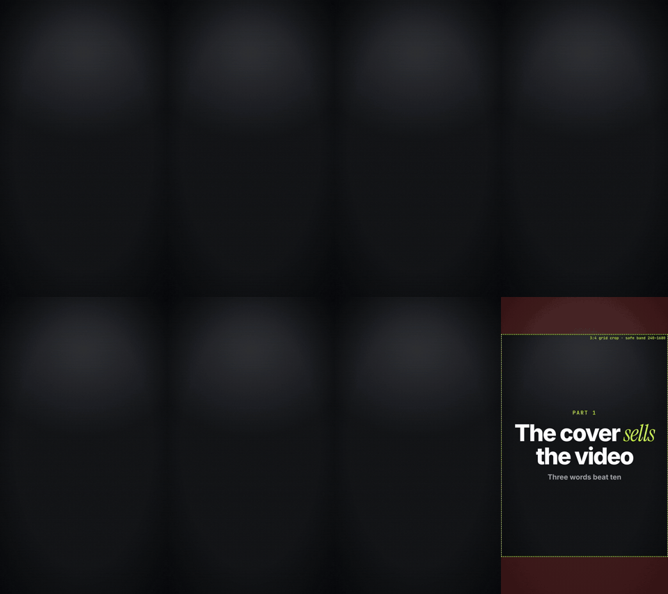

<div align="center">

# motionforge

**动态设计视频，由你的编程智能体用代码写出来。**

描述你想要的视频。智能体会写好开头钩子和脚本，把每个词对齐到配音，搭建场景、渲染，并在交给你之前先自行检查。

[English](../../README.md) · [Türkçe](README.tr.md) · [Español](README.es.md) · [Português (BR)](README.pt-BR.md) · [Français](README.fr.md) · [Deutsch](README.de.md) · [简体中文](README.zh-CN.md) · [日本語](README.ja.md) · [한국어](README.ko.md) · [हिन्दी](README.hi.md)

   

</div>

<p align="center"></p>

---

## 它能做什么

你输入类似这样的内容：

> 做一条 60 秒的竖屏短视频，介绍我每天都在用的 5 个免费工具。深色风格，用我的声音，加字幕。

motionforge 会按一套固定流程，把它变成一个经过检查的 MP4：

| 阶段 | 内容 |
|---|---|
| **需求确认** | 智能体用一句话复述你的需求，只询问缺少的信息（画幅、时长、语言、配音）。 |
| **钩子与脚本** | 2–3 个开头钩子备选、一份按口播节奏写的脚本，以及一份需要你核实的事实陈述清单。不编造数据。不用套话式的“AI 腔”（10 种语言的禁用短语清单）。 |
| **配音** | 使用你自己的 TTS 密钥（ElevenLabs、OpenAI）或本地模型。任何付费调用之前，智能体都会先说明费用，等你回复“可以”再执行。 |
| **时间轴** | 从配音中提取逐词时间戳，让每个标题、logo 和字幕都准确出现在对应的词被说出的那一刻。 |
| **风格与品牌** | 从风格库中选一种视觉风格，并套用你的 `brand.json`（颜色、字体、logo、水印、片尾）。 |
| **场景** | 以确定性代码构建，可以定位到任意时间点：默认使用 HyperFrames（HTML + GSAP），更合适时使用 Remotion 或 canvas 引擎。 |
| **QA** | 缩略图总览（contact sheet）、文字溢出与安全区检查、画面文字的阅读时长、响度，以及一位在全新上下文中工作、从未参与编写场景的评审。 |
| **交付** | 9:16 / 1:1 / 16:9 的 MP4、封面图、字幕和发布文案。按时间点提修改：“把 0:12 的标题改一下”。 |

## 安装

### Claude Code（插件）

```text
/plugin marketplace add aykutucesai/motionforge
/plugin install motionforge@motionforge
```

之后直接让它做视频即可，`motion-director` skill 会接手。

### Codex、Cursor 及其他智能体

```bash
git clone https://github.com/aykutucesai/motionforge
```

打开该文件夹（或将其加入你的项目），让智能体读取 [`AGENTS.md`](../../AGENTS.md)。每个 skill 都是写有精确命令的纯 Markdown，任何能读文件、能运行 shell 的智能体都可以照着执行。

### 环境要求

- Node.js 18+（推荐 22）和 ffmpeg
- Python 3.10+
- 可选：`faster-whisper`（逐词时间）、`rembg`（口播人像抠图）、`fonttools`（字形检查）、Playwright Chromium

智能体会在每个任务开始时检查这些依赖，并明确告诉你需要安装什么。

## 试试这些提示词

```text
把这段配音（voice.mp3）做成 9:16 的短视频。动态字幕，深色风格，我提到的每个产品都用真实 logo。
```
```text
用这 4 张截图给我的 App 做一个 30 秒的产品发布短片。使用我的品牌套件。
```
```text
用西班牙语写 3 个开头钩子备选和一份 70 秒的脚本，主题是如何在软件上省钱。先不要生成音频。
```
```text
这是一段我坐在桌前的 10 秒视频。前 5 秒用作开场，后 5 秒用作结尾，中间放图形动画。
```

## 目录结构

```
motionforge/
├─ AGENTS.md                 所有智能体的入口
├─ skills/
│  ├─ motion-director/       完整工作流及其审批节点
│  ├─ script-and-hooks/      钩子、脚本、事实清单、禁用短语（10 种语言）
│  ├─ voice-and-timing/      经你同意才调用的 TTS、逐词时间、字幕、响度
│  ├─ style-library/         20 种风格，每种一个 STYLE.md
│  ├─ brand-kit/             brand.json：颜色、字体、logo、水印、片尾
│  └─ qa-review/             检查项 + 独立评审
├─ engines/
│  ├─ hyperframes/           默认引擎（HTML + GSAP，Apache-2.0）
│  ├─ remotion/              可选的 React 引擎 + 工具包
│  └─ canvas/                frame = f(t) 页面，用于手绘和程序化风格
├─ templates/                现成场景：动态标题、字幕、计数器、浏览器、手机、聊天、清单、封面
└─ tools/                    逐词时间、抠图、响度、缩略图总览、文字检查、导出、封面安全区
```

## 原则

1. **默认对所有人免费。** 默认引擎 HyperFrames 采用 Apache-2.0 许可。Remotion 为可选项（见[许可说明](../LICENSING.md)）。
2. **确定性。** 每一帧都是时间的函数。输入相同，视频就相同。
3. **未经同意，不产生任何费用。** 智能体会先说明费用。
4. **内容诚实。** 需要来源的说法会列出来交给你核实；模拟界面会明确标注。
5. **交付前必经检查。** 只要 QA 还有未解决的失败项，视频就不会交付。

## 语言

skill 指令以英文编写，面向智能体。智能体会用你的语言与你交流，并用视频所用的语言撰写脚本、字幕和画面文字。钩子模式和禁用短语清单直接用以下各语言编写，而非翻译：

English · Türkçe · Español · Português (Brasil) · Français · Deutsch · 简体中文 · 日本語 · 한국어 · हिन्दी

## 许可

motionforge 以 [MIT 许可证](../../LICENSE)发布。它会调用第三方工具，这些工具各自保留其许可；参见 [THIRD_PARTY.md](../../THIRD_PARTY.md) 和用通俗语言写成的说明 [docs/LICENSING.md](../LICENSING.md)。要点如下：HyperFrames 采用 Apache-2.0；GSAP 通过 npm 安装，遵循其自身许可；Remotion 对个人及员工不超过 3 人的公司免费，超过这一规模需购买公司许可。

## 参与贡献

欢迎提交 issue 和 pull request：新风格、模板、语言清单、引擎改进都可以。请先阅读 [CONTRIBUTING.md](../../CONTRIBUTING.md)。

---

<div align="center">

Made by <a href="https://www.instagram.com/aykutucesai/">Aykut Üçeş</a> · <a href="https://x.com/Aykutuces">@Aykutuces</a>

</div>
