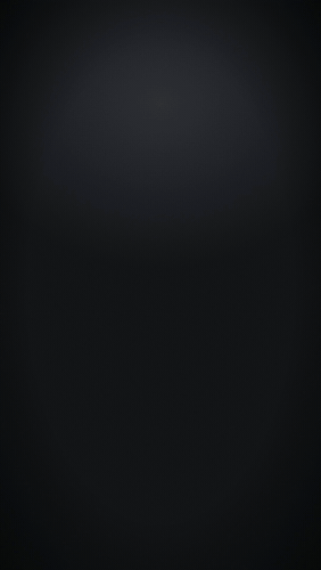
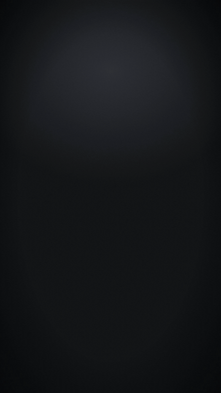
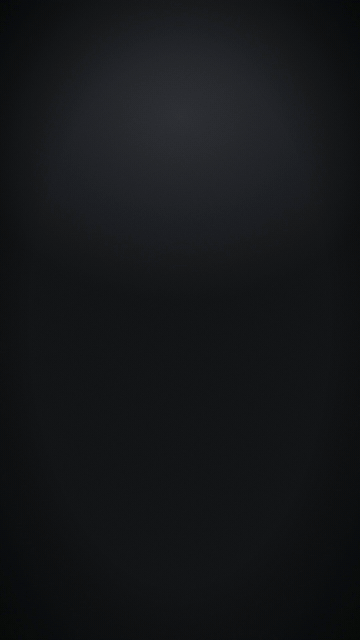
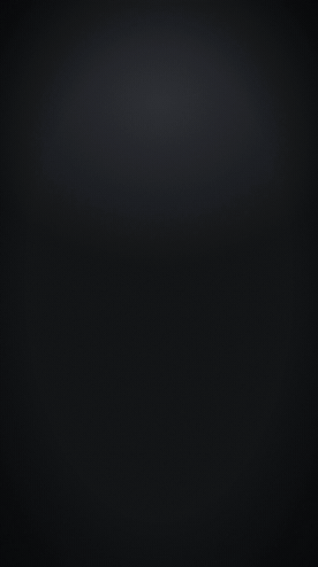
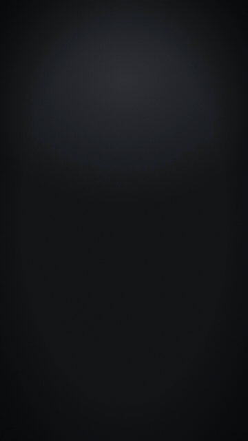
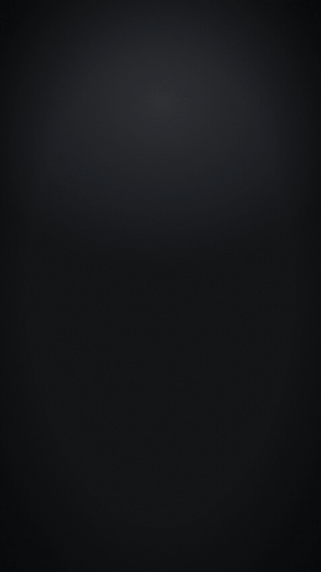
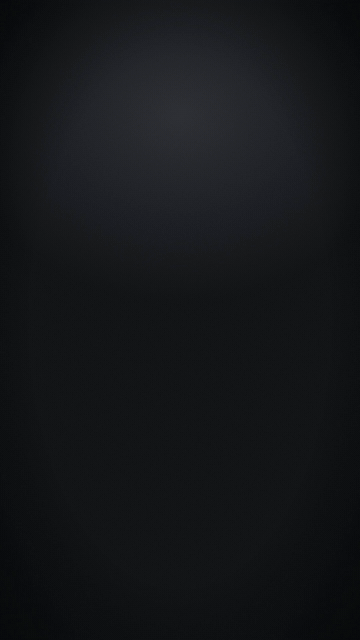
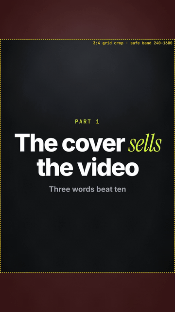

# Templates

Small, seekable HyperFrames scenes. Each folder has `index.html` (the scene), `params.json` (what you can change) and `preview.gif`.

Scaffold one into your project:

```bash
engines/hyperframes/scripts/new-scene.sh my-scene --template <name> --params values.json
```

<table>
<tr><td align="center" valign="top" width="25%"><br><b><code>kinetic-title</code></b><br><sub>One to three lines that build word by word (blur-rise with a small overshoot); one accent word in the italic serif and accent colour; optional underline sweep and exit.</sub></td><td align="center" valign="top" width="25%"><br><b><code>word-captions</code></b><br><sub>Short caption chunks that follow the voiceover; the word being spoken is in the accent colour, spoken words turn white, upcoming words are dimmed. A new chunk starts at a pause, a sentence end or maxWords.</sub></td><td align="center" valign="top" width="25%"><br><b><code>stat-counter</code></b><br><sub>One big number that counts up with a progress ring, a label and an on-screen source line. Every number needs a real, named source.</sub></td><td align="center" valign="top" width="25%"><br><b><code>phone-ui</code></b><br><sub>A phone that rises in and shows an app screen: a real screenshot (scrolls gently) or a simple list built from params, followed by a tap on one item.</sub></td></tr>
<tr><td align="center" valign="top" width="25%"><br><b><code>chat-thread</code></b><br><sub>A generic messaging conversation that builds message by message, with a typing indicator before each incoming message; older messages move up as new ones arrive.</sub></td><td align="center" valign="top" width="25%"><br><b><code>browser-window</code></b><br><sub>A real screenshot inside a browser frame: rises in with a slight tilt, scrolls, then zooms to a highlighted region with an accent box and a callout.</sub></td><td align="center" valign="top" width="25%"><br><b><code>checklist-reveal</code></b><br><sub>A title, then items that slide in one by one and get a drawn check mark; times can follow the voiceover.</sub></td><td align="center" valign="top" width="25%"><br><b><code>cover-still</code></b><br><sub>A 1080x1920 cover with kicker, headline (accent word) and subline kept inside the 3:4 grid crop / safe band (y 240-1680), over the standard backdrop or a darkened photo. Includes a drafting guide.</sub></td></tr>
</table>
